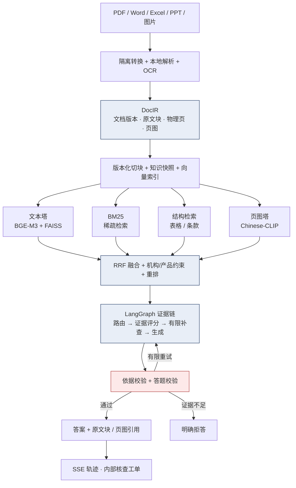

# 金融多模态知识与业务协作 Agent 平台

> 面向金融业务文档的多模态检索与问答平台：**从 923 份多格式文档，到一条可溯源、可拒答、可审计的答案。**
>
> 不是「接个大模型做问答」，而是把 **证据链、幻觉校验、预算熔断、检查点恢复** 做成工程约束。

<!-- CI 徽章在 P0-3 接入 Actions 后启用 -->


---

## 它解决什么问题

金融业务文档有三个特点，普通 RAG 直接上会翻车：

| 现实问题 | 常见做法 | 本项目的做法 |
|---|---|---|
| 文档格式杂（PDF / Word / Excel / PPT / 扫描件），表格与图表承载关键信息 | 只抽文本，图表信息丢失 | 统一中间表示 **DocIR**（文档版本 / 原文块 / 物理页 / 页图），文本与页图双通道检索 |
| 答错代价高，模型会「编」 | 让模型直接答，事后人工核对 | **依据校验 + 答题校验**双层拦截，证据不足明确拒答 |
| 调用成本不可控 | 跑完才发现账单 | **token 账本 + 预算熔断**，超限即停，不越权重跑 |

一句话：**把"模型能不能答"变成"系统允不允许答"。**

---

## 架构



**四通道各自保留独立分数，不做归一化相加**：视觉相似度和文本相似度不是同一种量纲，直接相加会让"看起来像"压过"内容对"。

---

## 关键数字

> 数据来自 2026-09-30 的实际运行记录，评测报告与原始问答均在仓库内可查。

| 指标 | 数值 | 出处 |
|---|---|---|
| 测试 | **479 passed / 4 skipped / 12 subtests** | `pytest -q`（约 14s） |
| 代码规模 | **213 个 Python 文件**（app 29 / src 46 / tests 79 / scripts 56） | `cloc` 口径 |
| 语料规模 | **920 份**业务文件 → **30,406** 检索切块 → **17,957** 张页图 | `docs/baseline/2026-09-29-delivery-audit.md` |
| 真实模型评测 | 50 题完成 **43 题**（第 44 题预算耗尽） | `output/quality/financial50-live-v1.json` |
| 延迟 | **p50 30.5s / p95 60.2s** | 同上 |
| 预算 | 累计 **1,488,843 / 1,500,000** tokens，触发熔断即停 | 预算账本 |
| 解析兼容率 | **100%**（1,146 个文件的历史评测口径） | 早期评测报告 |

---

## 快速开始

```bash
# 1) 环境（Python 3.11）
python -m venv .venv && .venv\Scripts\activate && pip install -r requirements.txt

# 2) 配置：至少填一个模型 Key；不填则进入 Mock 模式（见 docs/PRD.md P0-2）
copy .env.example .env

# 3) 启动（前后端同一个 FastAPI 服务）
python -m app.main          # 打开 http://127.0.0.1:8001，/api/health 应为 ready=true
```

**回归测试**（不调用付费 API）：

```bash
set FINANCE_DISABLE_PAID_API=1
.venv\Scripts\python.exe -m pytest -q
```

**Docker（可选，尚未完成端到端验收）**：

```bash
docker compose up -d
```

> 说明：`data/` 下的原始语料与 `output/` 下的知识产物、向量缓存、模型权重不入库，需本地自行准备（见 `.gitignore` 说明）。

---

## 目录结构

```text
Financial_QA/
├── app/                # FastAPI 服务层：JWT、会话、run 生命周期、SSE、证据鉴权、工单、运维
├── src/
│   ├── pipeline/       # 多格式解析、DocIR、身份、表格切块、快照、质量门禁
│   ├── system/         # 多通道检索、RRF、机构过滤、模型适配、预算
│   └── agent/          # LangGraph 节点、条件边、提示词、持久节点日志
├── frontend/           # Vue3：登录、问答、轨迹、原文原图、取消与运维
├── tests/              # pytest：单测 + 真实 HTTP 验收
├── scripts/            # 数据处理、评测、备份、回归
├── docs/               # 设计、审计、runbook（26 篇）
└── configs/            # 模型注册表
```

---

## 核心设计

### 1. 文档统一表示 DocIR

所有格式先落到同一层中间表示：**文档版本、原文块、物理页或结构位置、页图**。块级保留 `source_doc / page / block_id`，答案才能回指到原文。

### 2. 四通道检索 + RRF 融合

文本向量（BGE-M3 + FAISS）、BM25、结构检索、页图（Chinese-CLIP）各自保留分数；RRF 融合后做机构与产品约束重排。页图检索失败**不伪造文本代理向量**。

### 3. LangGraph 证据链

```
路由 → 证据评分 → 有限补查 → 生成 → 依据校验 + 答题校验
                    ↑                              |
                    └──────── 有限重试 ────────────┘
```

节点总步数硬限制 **32**，检索与生成重试各自有限额。取消会阻断后续节点，已发送的远端请求不保证撤回或免计费，**迟到的答案不发布**。

### 4. 预算账本与熔断

按 run 记账、按轮结算，累计触达上限即置 `budget_exhausted` 并停止调用。**不允许通过回退账本来获得新额度。**

### 5. 检查点与幂等恢复

run、事件、LangGraph 检查点与节点结果持久化；恢复时复用已落盘结果。未知模型结果、不同代码或配置、过期任务**不自动重放**。

---

## 评测与边界（重要）

这份 README 只写**已经发生**的事，没做到的单独列出来：

**已做到**
- 479 项自动化测试通过，含真实 HTTP 验收（不调用付费 API）
- 920 份文件入库，30,406 切块，17,957 张页图
- 50 题真实模型评测完成 43 题，延迟与 token 账本可查
- 证据不足时明确拒答，答案附原文块与页图引用

**未做到（不宣称）**
- ❌ 500 题准确率门禁**未通过**：题源表缺人工标准答案与证据，正式准确率指标保持"未通过"
- ❌ 39 个"模型校验标记"不等于 39 个人工正确答案
- ❌ 单次 RAG 对照未运行，**不报告 A/B 准确率提升**
- ❌ 图谱 1,792 条关系**未通过语义复核**，默认不上线
- ❌ 多租户私有文档 ACL 未实现（当前知识快照对登录用户共享，run / 会话 / 证据 / 工单按用户隔离）
- ❌ Docker 部署未做端到端验收，公网生产上线未验收

> 这一节的用意：**能说清边界的人，才值得相信他说的数字。**

---

## 文档

| 文档 | 内容 |
|---|---|
| [docs/PRD.md](docs/PRD.md) | 可信度改造 PRD（门面 / 证据 / 差异三层任务） |
| [docs/baseline/2026-09-29-delivery-audit.md](docs/baseline/2026-09-29-delivery-audit.md) | 交付审计：实际规模与未完成项 |
| [docs/deployment-readiness.md](docs/deployment-readiness.md) | 部署边界说明 |
| [docs/2026-09-21-agentic-rag-upgrade-master-plan.md](docs/2026-09-21-agentic-rag-upgrade-master-plan.md) | Agentic RAG 升级总纲 |

---

## License

MIT © 2026 张艳

