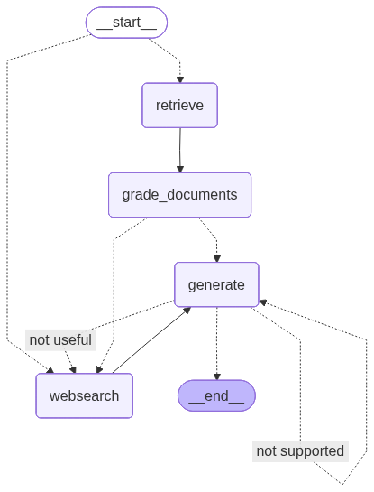

# Agentic RAG v3 — 自适应检索 + 自纠正（最小实现）

一个**刻意保持最小**的 Agentic RAG 参考实现：不追求功能覆盖，只把
「路由 → 检索 → 评分 → 生成 → 双校验 → 重试/拒答」这条闭环写清楚。

它和仓库根目录的生产平台是**对照关系**，不是重复：

| 维度 | 本目录（v3，最小实现） | 根目录 Financial_QA（生产平台） |
|---|---|---|
| 目标 | 把范式讲清楚 | 把系统跑起来 |
| 检索 | Chroma + 单塔向量 | 文本 / BM25 / 结构 / 页图 四通道 + RRF |
| 文档层 | 直接切块 | DocIR（版本 / 原文块 / 物理页 / 页图） |
| 校验 | 依据 + 答题两级 | 同上 + 证据门禁 + 预算熔断 |
| 依赖 | langgraph + langchain + chroma | + faiss / torch / BGE-M3 / CLIP / FastAPI / Vue |
| 测试 | 7 条路由与限流测试 | 490 条 |

> 一句话：**v3 用来说明"为什么这样编排"，生产平台用来说明"这样编排能扛住什么"。**

---

## 图结构



```text
route_question（条件入口，二选一分类）
 ├─ vectorstore → retrieve → grade_documents
 └─ websearch   → web_search

grade_documents（逐篇二分类，任一不相关即补检索）
 ├─ 有不相关 → web_search → generate
 └─ 全相关   → generate

generate → hallucination_grader（是否基于文档）
 ├─ not supported → generate（重试；达 MAX_ITERATIONS 后 give_up 拒答）
 └─ 通过 → answer_grader（是否回答问题）
            ├─ useful     → END
            └─ not useful → web_search（换源）

give_up → END（明确拒答，不硬编答案）
```

---

## 三个关键设计

**1. 路由字段用 `Literal` 强约束**
`chains/router.py` 里 `datasource: Literal["vectorstore", "websearch"]` +
`with_structured_output(method="function_calling")`：把开放生成降维成二选一分类，
避免自由文本解析失败。

**2. 逐文档打分，而不是整体打分**
`nodes/grade_documents.py`：只要有一篇不相关就置 `web_search=True`——
**宁可多搜一次，也不让脏文档进上下文**。

**3. 两级校验分离，错误类型决定补救动作**
- 幻觉（不基于文档）→ 用同一批文档**重新生成**
- 偏题（没回答问题）→ **换信息源**重新检索

---

## 本轮补上的两个工程约束

| 约束 | 位置 | 说明 |
|---|---|---|
| `MAX_ITERATIONS = 2` | `graph/consts.py` | 用**状态计数**限制自纠正重试；超限走 `give_up` 明确拒答 |
| 墙钟超时 | `graph/runtime.py` | `invoke_with_timeout` / `stream_with_timeout`，避免模型或检索卡死把请求挂住 |
| 显式 `recursion_limit` | `graph/runtime.py`、`server.py` | 不依赖框架默认值 |

对应测试：`graph/tests/test_limits.py`（重试到上限 → 拒答；超时 → `GraphTimeoutError`）。

---

## 运行

```bash
pip install -r requirements.txt
cp .env.example .env        # 填 OPENAI_API_KEY（默认指向 DeepSeek 兼容接口）
python -m graph.graph       # 命令行跑一题
python server.py            # 或起 FastAPI，访问 http://127.0.0.1:8000
```

## 测试

```bash
cd ..                       # 回到仓库根目录
pytest agentic-rag-v3/graph/tests -q   # 需要项目自身依赖
```

> 注意：本目录的测试不被根目录 `pytest.ini` 的 `testpaths = tests` 收集，
> 需要显式指定路径运行。

---

## 已知边界（不掩饰）

- 语料是 5 段示例文档（agent memory / prompt engineering / adversarial attacks），
  **不是业务语料**——它演示的是编排，不是效果。
- `web_search` 默认**失败关闭**（未配置真实搜索 provider 时抛 `ExternalSearchDisabled`），
  避免"看起来能搜、其实编来源"。
- 没有向量库持久化与并发控制，超过 10 个并发会明显变慢。
