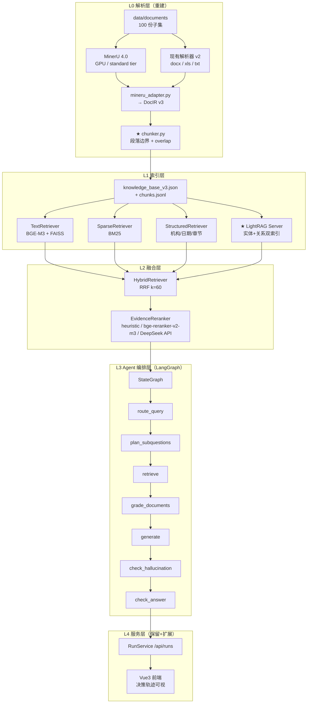
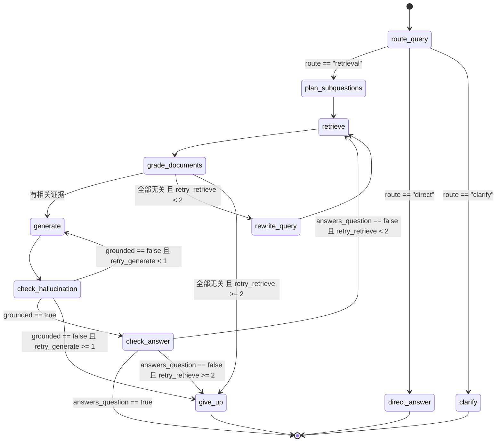

# Agentic RAG 三阶段升级总方案（A 解析切块重建 → B LightRAG 图通道 → C LangGraph Agent 编排）

> 版本：1.0
> 日期：2026-09-21
> 适用仓库：`finance-qa-platform`
> 上位文档：`docs/superpowers/specs/2026-09-19-financial-agentic-rag-integration-design.md`
> 状态：待用户确认后进入实施

---

## 0. 本次决策摘要

| 决策项 | 结论 |
|---|---|
| 实施顺序 | **A → B → C 分阶段验收**，每阶段都有可回退基线与量化验收 |
| LightRAG 定位 | **第 4 检索通道**，与现有 dense/sparse/structured 一起走 RRF 融合 |
| 数据规模 | **先做 100 份子集**（覆盖全部文档形态），跑通后再决定是否全量 924 份 |
| Agent 编排 | **引入 LangGraph**，实现「路由 → 检索 → 相关性评分 → 分支 → 生成 → 双层校验」闭环 |
| 评测标准 | **人工金标准（30~50 题）+ LLM 辅助粗筛** |
| 运行环境 | **按本机全量设计（RTX 3080 10GB + 31GB RAM），保留低内存降级开关** |

---

## 1. 现状诊断（实测数据，不是推测）

### 1.1 主链路事实

```
data/documents (924 文件 / 1.06 GB)
  → scripts/preprocess.py
  → output/knowledge_base.json  (507 MB, 1146 docs, 18070 pages, 481,276 blocks)
  → src/system/retrieval.py :: KnowledgeStore.load()
  → TextRetriever (BGE-M3 1024d, FAISS IndexFlatIP + L2)
  → dense + sparse + structured + graph(null) → RRF(k=60) → rerank → DocumentAgent
```

**关键事实：阶段 2 的 DocIR v2 / 快照 / 指纹从未在主链路启用。** `output/` 下没有
`phase2/` 目录、没有 manifest，`KnowledgeStore.load()` 一直走 legacy 分支
（`_ingest_pages_from_doc`）。阶段 3 评测读的也是这份 2026-05-13 的旧知识库。

### 1.2 知识库实测缺陷

| 指标 | 实测值 | 结论 |
|---|---:|---|
| 文档数 / 页数 / 块数 | 1146 / 18070 / 481,040 | — |
| **文档重复** | 572 唯一 × 2 = 1146 | **整库重复两份** |
| **block_id 重复种类** | 240,519 | 一半块无法唯一标识 |
| `section_path` 非空 | **0** | 章节结构 100% 丢失 |
| `ocr_used` 块 | **0** | 扫描件等于没解析 |
| `table` 块 | **236**（0.05%） | 表格几乎未抽取 |
| 含 `\|` 的块 | 800（0.17%） | 同上 |
| **块长中位数** | **30 字** | 检索单元严重过碎 |
| 块长 0–50 字占比 | **83.5%** | 同上 |
| **以句末标点结尾的块** | **18.8%**（PDF 仅 15.5%） | **84.5% 的块从句子中间被切断** |
| 无中文块 | 82,116（17.1%） | 图表坐标轴/页码噪声进索引 |
| 纯数字/标点块 | 65,044（13.5%） | 同上 |
| `heading` 误标 | 349,458（72.6%） | `len(text)<80` 被判成标题 |
| 页图 `image_ref` | 17,780 页有引用，**抽样 30 个全部指向不存在的 F 盘路径** | 视觉/图表通道完全失效 |

**块粒度是双峰病态**：PDF 是 1~2 行的碎片（`page.get_text("blocks")` 未做段落重组），
`.txt` 是「整篇一个块」（最长 8507 字，`PlainTextParser` 把全文塞进一个 DocBlock）。

### 1.3 阶段 3 门禁失败的三层原因

| 层 | 问题 | 证据 |
|---|---|---|
| **测量层** | gold 标准无效 | `golden_retrieval.json` 的 `source=baseline_auto_provisional`，取自一次 **20 块**冒烟测试；qid=130/21/99 三题的 gold 证据全部来自同一份《2002 年已废止的中间业务通知》，而 qid=21 问的是"中国太保 2023 年度业绩说明会"。`dense=0.0000` 是语义检索**正确地**拒绝了无关内容 |
| **语料层** | 抽样严重偏斜 | `build_phase3_eval_corpus.py` 的 background 是「按文件顺序取前 N 块」；2996 块语料里单文档占 **31.7%**，前 5 份文档占 66% |
| **流水线层** | 真实缺陷 | 碎片切块（83.5% < 50 字）、表格缺失（236 块）、OCR 为 0、图表未处理、整库重复、章节丢失 |

阶段 3 的**算法实现本身是对的**（四通道 + RRF + 分数隔离 + 指标计算 + 门禁脚本 +
120 个测试全绿），失败在**被测对象和被测标准**。

### 1.4 评测资源的真实情况

| 文件 | 行数 | 列 | 有无答案 |
|---|---:|---|---|
| `test/100道测试集（含答案）.xlsx` | 100 | `question_id, question` | ❌ 文件名说"含答案"，实际没有 |
| `test/400道测试集（含答案）.xlsx` | 400 | `question_id, question` | ❌ |
| `test/merged.xlsx` | 500 | `question_id, question` | ❌ |

**500 个问题，零参考答案、零证据标注。** 这是评测体系的根本障碍。

### 1.5 环境实测

| 项 | 值 | 影响 |
|---|---|---|
| GPU | RTX 3080, 10240 MiB, driver 616.56 | ✅ 满足 `mineru[full]`（需 NVIDIA ≥8GB VRAM） |
| RAM | 31.4 GB | ✅ 满足 `mineru[full]`（需 ≥16GB） |
| CPU | Intel Core Ultra 7 265K（20 核） | ✅ |
| 磁盘 | C 盘剩余 574 GB | ✅ |
| DeepSeek Key | `.env` 已配置 | ✅ LightRAG EXTRACT/QUERY/KEYWORD 可用 |
| 已有模型 | `BAAI/bge-m3`、`Qwen/Qwen2-1.5B-Instruct` | ✅ LightRAG 官方推荐正是 bge-m3 |
| 缺失 | `mineru`、`lightrag`、`bge-reranker-v2-m3` | 需安装/下载 |
| ⚠️ 地雷 | `.env` 中 `CUDA_VISIBLE_DEVICES=`（**空值**） | 会让 CUDA 看不到 GPU，MinerU 退化成 CPU（几小时→几天）。**必须修** |
| ⚠️ 地雷 | `.venv` 的 uv Python 3.11.13 已被删除 | 所有 runbook 里 `.\.venv\Scripts\python.exe` 命令全部失败 |

---

## 2. 目标架构

### 2.1 分层全景



### 2.2 检索单元契约（贯穿全链路的主键）

这是本次升级最关键的设计。所有通道必须能映射到同一个 `chunk_id`：

```
chunk_id = "ck_" + stable_digest(document_version | block_ids_joined | chunker_version)[:32]

Evidence / Chunk 统一字段：
  chunk_id, block_ids[], document_id, document_version, snapshot_id
  source_doc, page_start, page_end, bbox_union
  section_path, block_type, parent_block_id
  content, token_estimate
  dense_score, sparse_score, structured_score, graph_score
  dense_rrf, sparse_rrf, structured_rrf, graph_rrf, fusion_rank, fusion_score, rerank_score
  retrieval_channels[]
  quality_flags[]
```

**只有拿到统一 `chunk_id`，才能做 4 通道 RRF、才能让 LightRAG 的图证据和 FAISS 的文本证据对齐、才能让 Evidence 可追溯到页码。**

---

## 3. 阶段 A：解析与切块重建

### 3.1 A1 — MinerU 4.0 接入

#### 3.1.1 安装与配置

```bash
# 修正 .env 地雷（关键！）
# CUDA_VISIBLE_DEVICES=  ← 删掉这一行，或改为 CUDA_VISIBLE_DEVICES=0

# 修复 .venv（uv Python 被删）
uv python install 3.11

# 安装 MinerU（GPU 全速版，3080 10GB 满足要求）
uv tool install --force "mineru[full]>=4.0,<5"

# 校验
mineru version --json
mineru server status --json

# 下载 standard tier 模型（约 2GB）
mineru-kit models download --tier standard
mineru-kit models verify --tier standard

# 启用本地托管解析服务
mineru config set parse_server.local.managed_tier standard
mineru config set parse_server.local.mode managed
mineru server start
mineru server status --json
```

> ⚠️ 注意：你原文给的第 3 段示例 `from mineru import MinerU; MinerU().convert(...)`
> **在任何版本都不存在**。4.0 的正确入口是 `from mineru.parser import parse` 或
> `mineru-kit parse` CLI。本方案统一走 **CLI（subprocess）**，避免 Python API 随版本漂移。

#### 3.1.2 解析调用

```bash
# 无状态批量解析，输出 markdown + middle_json + zip(含图片)
mineru-kit parse "input.pdf" \
  --tier standard \
  --format middle_json,zip \
  -o "output/kb_v3/parsed/<doc_key>/"
```

产出：

```
output/kb_v3/parsed/<doc_key>/
├── markdown.md
├── middle_json.json          ← 语义块主数据源
├── images/
│   ├── page_0_image_0.png
│   ├── page_3_table_0.png    ← 表格区域图
│   └── page_5_chart_0.png    ← ★ 图表区域图（MinerU 原生识别）
└── ...
```

`MiddleJson` 的 `pages[].blocks[]` 是**语义块**（不是文本对象行），`page_idx` 是 0-based，
`extensions.mineru.tier` 记录实际档位。图片命名规则 `page_{page_idx}_{parent_type}_{parent_index}.ext`
中的 `parent_type` ∈ `{image, table, chart, equation}` —— **这直接解决了"图表完全没处理"的问题**。

#### 3.1.3 新增 `src/pipeline/mineru_adapter.py`

```python
"""MinerU 4.0 MiddleJson → DocIR v3 适配器。"""
from __future__ import annotations
from pathlib import Path
from typing import Any, Dict, List, Optional

from .docir import DocBlock, DocIR, DocPage
from .identity import ParseContext, make_block_id, make_document_version
from .tables import normalize_table

MINERU_PARSER_VERSION = "mineru-4.0"
_IMAGE_PARENT_TYPES = {"image", "table", "chart", "equation"}


def parse_with_mineru(
    file_path: Path,
    parsed_dir: Path,
    context: ParseContext,
    *,
    tier: str = "standard",
) -> DocIR:
    """调用 mineru-kit CLI 并转换为 DocIR v3。

    失败时抛出 MineruUnavailable，由上层回退到 PDFDocumentParser(v2)。
    """
    ...


def middle_json_to_docir(
    middle: Dict[str, Any],
    parsed_dir: Path,
    file_path: Path,
    context: ParseContext,
    *,
    tier: str,
) -> DocIR:
    """MiddleJson → DocIR。block type 映射规则见下表。"""
```

**block type 映射表**：

| MiddleJson block type | DocIR `block_type` | 处理方式 |
|---|---|---|
| `text`（含 `level` 标题信息） | `heading` | `section_path` 入栈 |
| `text`（正文） | `paragraph` | 合并到语义单元 |
| `table` | `table` + `table_rows` | 调 `normalize_table()`，复用现有行组/表头/单位逻辑 |
| `image` | `figure` | `figure_kind="image"`，记录 `figure_ref` |
| `chart` | `figure` | **`figure_kind="chart"`**，记录 `figure_ref` |
| `equation` / `interline_equation` | `equation` | `formula_latex=content` |
| 其余 | `paragraph` | 兜底，打 `quality_flags=["unknown_block_type"]` |

**新增 DocBlock 字段**（DocIR schema v3）：

```python
figure_ref: Optional[str] = None       # images/page_5_chart_0.png 相对路径
figure_kind: Optional[str] = None      # chart | image | diagram
figure_caption: Optional[str] = None   # 图题
figure_text: Optional[str] = None      # 图内文字（MinerU 抽取的 chart 文本）
chunk_ids: List[str] = field(default_factory=list)   # 反向索引：块被哪些 chunk 引用
```

**质量护栏**：
1. MinerU 失败 → 记 `quality_flags=["mineru_fallback"]` → 回退 `PDFDocumentParser`(v2) →
   再失败才整篇失败。**任何回退都要写进 `parser_report.json`，不允许静默。**
2. 每份文档校验：`page` 覆盖率、`section_path` 覆盖率、块数 > 0、无重复 `block_id`
3. 抽样 20 份人工核对：页码真实、表格结构正确、图题与图对应

#### 3.1.4 修改 `src/pipeline/parsers.py`

| 解析器 | 改动 |
|---|---|
| `PDFDocumentParser` | 降级为**回退路径**；保留但补两个 bug：① `_needs_ocr` 的触发条件从「本页零文本块」改为「文本覆盖面积 < 阈值且排除页脚/页码」；② `_text_is_inside_table` 从「文字内容包含」改为「bbox 相交」，避免误删正文 |
| `PlainTextParser` | **修掉"整篇一个块"**：先按空行分段，每段一个 `paragraph` block，再交给 chunker |
| `WordDocumentParser` | 不变（v2 已正确：OOXML 单次遍历、`page=None`、嵌套表格） |
| `ExcelDocumentParser` | 不变（v2 已正确：工作表行定位、行组、截断标记） |

### 3.2 A2 — 切块器（本次核心）

#### 3.2.1 新增 `src/pipeline/chunker.py`

```python
"""段落优先 + 句边界 + overlap 的确定性切块器。"""
from __future__ import annotations
from dataclasses import dataclass, field
from typing import List, Optional

CHUNKER_VERSION = "chunker-v3"

# ---- 可配置参数（环境变量可覆盖）----
TARGET_CHARS = 600      # FINANCE_CHUNK_TARGET_CHARS
MAX_CHARS = 900         # FINANCE_CHUNK_MAX_CHARS
MIN_CHARS = 150         # FINANCE_CHUNK_MIN_CHARS
OVERLAP_CHARS = 96      # FINANCE_CHUNK_OVERLAP_CHARS ≈ 16% of target

# 句末标点（中英）后跟可选右引号/右括号
SENTENCE_END = "。！？；!?;"
PARAGRAPH_END = "\n\n"


@dataclass
class Chunk:
    chunk_id: str
    text: str
    block_ids: List[str]
    page_start: Optional[int]
    page_end: Optional[int]
    bbox_union: Optional[List[float]]
    section_path: Optional[str]
    block_type: str
    parent_block_id: Optional[str]
    token_estimate: int
    quality_flags: List[str] = field(default_factory=list)


def build_chunks(blocks, *, document_version: str) -> List[Chunk]:
    """把 DocBlock 序列切成检索单元。算法见下。"""
```

#### 3.2.2 算法：四步

**第 1 步 · 语义单元化**

先把 `DocBlock` 序列转成「原子单元」序列，并标出**不可跨越的硬边界**：

| 单元类型 | 是否原子 | 硬边界 |
|---|---|---|
| `heading` | ✅ 原子 | 前后都断（标题独立成块，或作为下一个 chunk 的 `[章节]` 前缀） |
| `table_rows`（每组 ≤20 行） | ✅ 原子 | 前后都断；**永不与正文合并** |
| `figure` / `equation` | ✅ 原子 | 前后都断 |
| `paragraph` / `list_item` | ❌ 可合并 | 只在 `page` 变化或 `section_path` 变化时断 |

**第 2 步 · 目标长度累加**

```
cursor = 0
while 还有单元:
    current = []
    chars = 0
    while 下一个单元 u:
        if 硬边界(u) and current: break
        if chars + len(u) > MAX_CHARS and current: break
        current.append(u); chars += len(u)
        if chars >= TARGET_CHARS and 下一个单元是空行/段末: break
    emit(current)
```

**第 3 步 · 句子边界回退**

如果 `current` 的最后一个单元是 `paragraph`，且拼接长度超过 `TARGET_CHARS`，
就从后往前找**最后一个完整句子的句末标点**，在那里切断，把尾巴留给下一段：

```python
def _split_at_sentence(text: str, limit: int) -> tuple[str, str]:
    """在 limit 之前最后一个句末标点处切分，返回 (head, tail)。"""
    idx = max(text.rfind(p, 0, limit) for p in SENTENCE_END)
    if idx < MIN_CHARS:            # 找不到合适的句子边界
        return text[:limit], text[limit:]   # 硬切并打标记
    return text[: idx + 1], text[idx + 1 :]
```

硬切时打 `quality_flags=["hard_split"]`，便于事后审计。

**第 4 步 · overlap 填充（句对齐，不是字符对齐）**

```
emit 完 chunk_i 后：
    tail = chunk_i 末尾
    从 tail 的末尾往前，累计到 >= OVERLAP_CHARS，且必须停在一个句末标点上
    → overlap_text = 这段完整句子序列
    → 它成为 chunk_{i+1} 的起始前缀
```

**为什么必须句对齐**：如果按字符重叠（例如末尾 96 个字），切出来的前缀一定是半句话，
既会误导 BM25 的分词，也会让 reranker 的 token overlap 计算失真。

**保护规则**：
1. `min_chars=150`：段落类 chunk 过短则与相邻同类 chunk 合并（`heading`/表格/图 除外）
2. 单块 `> MAX_CHARS`：先按句子切，再按 `；`/`，`/换行兜底，最后才硬切
3. **表格 chunk 必须重复**：`[章节] … [表格] … [单位] … [列] …` + 表头 + 行号区间
   （直接复用现有 `src/pipeline/tables.py :: serialize_group()`，那部分设计本来就是对的）
4. **图表 chunk 内容** = `[章节]` + `图题` + `图内文字` +（可选）前后各一段相邻正文
5. **确定性**：相同输入必须产出相同 `chunk_id`（用 `src/pipeline/identity.py :: stable_digest`）
6. **overlap 上限**：连续 3 个 chunk 的重叠区不得死循环；单次切分总长度不得膨胀 > 130%

#### 3.2.3 切块参数建议（可调）

| 参数 | 值 | 理由 |
|---|---:|---|
| `TARGET_CHARS` | 600 | 中文 ≈ 400 tokens，BGE-M3 检索甜点区 |
| `MAX_CHARS` | 900 | 不超 BGE-M3 有效上下文，且 900 字以内语义集中 |
| `MIN_CHARS` | 150 | 低于此值的块语义信息不足 |
| `OVERLAP_CHARS` | 96 | ≈16%，覆盖跨块事实（"上一段末尾 + 下一段开头"的关联） |
| 表格行组 | ≤20 行 / ≤6000 字 | 沿用 v2 设计 |

#### 3.2.4 预期效果（对照当前）

| 指标 | 当前 | 目标 |
|---|---:|---:|
| 块长中位数 | 30 字 | ≥ 300 字 |
| < 100 字的块占比 | 83.5% | ≤ 10% |
| 以句末标点结尾 | 18.8% | ≥ 85% |
| 跨块事实完整率（抽样人工） | 无法估计 | ≥ 90% |
| 检索单元总数（100 份子集） | — | 预计从约 4 万块降到 3000~6000 chunk |

### 3.3 A3 — 知识库 v3 构建

#### 3.3.1 新增 `src/pipeline/kb_builder.py` 与 `scripts/build_kb_v3.py`

```
输入：output/kb_v3/parsed/<doc_key>/{middle_json.json, images/}  (MinerU)
      或 直接文件（docx/xls/txt 走现有 v2 解析器）
  ↓
① 去重：按 source_sha256 去重，同一内容只入库一次（修掉"整库重复两份"）
② 解析 → DocIR v3
③ 质量门禁（复用 src/pipeline/quality.py :: assess_document，新增 chunk 级检查）
④ build_chunks() → chunks
⑤ 落盘：
   output/kb_v3/knowledge_base_v3.json   # documents[].pages[].blocks[] + documents[].chunks[]
   output/kb_v3/chunks.jsonl             # 一行一个 chunk，供 FAISS/BM25/LightRAG 消费
   output/kb_v3/snapshot_manifest.json   # 复用 src/pipeline/snapshots.py
   output/kb_v3/parse_quality.json       # 聚合质量报告
   output/kb_v3/parser_report_v3.json    # 解析器命中/回退链
```

#### 3.3.2 质量报告新增字段（`src/pipeline/quality.py`）

```text
chunk_count
chunk_len_mean / chunk_len_p50 / chunk_len_p90
chunk_under_min_count            # 过短 chunk
chunk_hard_split_count           # 硬切 chunk
chunk_sentence_end_ratio         # 以句末标点结尾的比例  ← 关键验收指标
chunk_overlap_sample_count       # 有 overlap 的相邻 pair 数
section_path_coverage            # 章节覆盖率
table_chunk_count / figure_chunk_count / ocr_block_count
duplicate_block_id_count         # 必须为 0
document_duplicate_count         # 必须为 0
```

#### 3.3.3 修复 `KnowledgeStore` 的两条分支不一致

`src/system/retrieval.py :: KnowledgeStore`：

- legacy 分支 `_ingest_pages_from_doc()` **必须补齐** `section_path`、`table_headers`、
  `table_rows`、`unit`、`caption`、`parent_id`、`document_id`、`document_version`、`quality_flags`
  （现在只有 manifest 分支读这些字段，导致主链路拿不到章节/表格结构）
- 新增 `chunks.jsonl` 加载分支：优先按 chunk 加载；无 chunk 时回落按 block 加载（向后兼容）
- 演示模式（`max_blocks` / `doc_keywords`）必须**按 chunk 计数**，避免把 chunk 截断在句子中间

### 3.4 A4 — 评测体系重建

#### 3.4.1 金标准构建（`scripts/build_gold_set.py`）

```
① 从 test/merged.xlsx（500 题）分层抽样 30~50 题
   分层维度：文档类型（PDF文本/PDF扫描/财报表格/手册/制度文件）
             机构（工行/建行/交行/中信/太保/…）
             题型（事实抽取 / 数值计算 / 流程说明 / 跨文档对比）
② 用新链路检索出 top-20 候选证据
③ 人工确认：
   - 参考答案（人工写或修正 LLM 草稿）
   - gold_chunk_ids[]（必须实际包含答案的 chunk）
   - gold_pages[]（文档名 + 页码，用于人工核对）
④ 产出：
   output/eval/gold_set.json
   output/eval/gold_review.csv   ← 人工审核用（沿用现有格式）
   output/eval/corpus_stratified.jsonl  ← 分层随机采样语料（替代"取前 N 块"）
```

**抽样必须包含评测题来源文档**，否则题目在语料里无解（这是上次 3000 块语料 66% 集中在 5 份文档的教训）。

#### 3.4.2 A/B 评测（`scripts/eval_ab.py`）

对同一套 gold_set 跑两条链路的对照：

| 策略 | 说明 |
|---|---|
| `legacy_dense` | 旧 KB + 旧切块 + FAISS |
| `legacy_hybrid_rerank` | 旧链路最优（阶段 3 的 baseline） |
| `v3_dense` | 新 KB + 新 chunker + FAISS |
| `v3_hybrid` | + sparse + structured |
| `v3_hybrid_rerank` | + 重排 |

指标沿用阶段 3 已实现的（`scripts/eval_retrieval_phase3.py` 的 `recall_at_k` /
`mean_reciprocal_rank` / `ndcg_at_k`），**不重复造轮子**。

#### 3.4.3 门禁（扩展 `scripts/phase3_gate.py`）

```python
GATE_DEFAULTS = {
    "v3_hybrid_rerank.recall_at_10": 0.5,
    "v3_hybrid_rerank.mrr": 0.4,
    "v3_hybrid_rerank.ndcg_at_10": 0.4,
    # 新增：必须显著优于旧链路，防止"修完还是原样"
    "v3_hybrid_rerank.recall_at_10 >= legacy_hybrid_rerank.recall_at_10 * 1.5": True,
    # 新增：数据质量硬约束
    "chunk_sentence_end_ratio >= 0.85": True,
    "duplicate_block_id_count == 0": True,
    "document_duplicate_count == 0": True,
}
```

### 3.5 阶段 A 改造清单

**新增文件**

| 文件 | 职责 |
|---|---|
| `src/pipeline/mineru_adapter.py` | MinerU MiddleJson → DocIR v3 |
| `src/pipeline/chunker.py` | 段落+句边界+overlap 切块器 |
| `src/pipeline/kb_builder.py` | KB v3 构建（去重/解析/门禁/切块/落盘） |
| `scripts/build_kb_v3.py` | 一键重建 CLI |
| `scripts/build_gold_set.py` | 金标准构建辅助 |
| `scripts/eval_ab.py` | 新旧链路 A/B 评测 |
| `tests/unit/test_chunker.py` | 切块器单测（边界/overlap/确定性/表格保护） |
| `tests/unit/test_mineru_adapter.py` | 适配器单测（用小 fixture，不打网络） |
| `tests/unit/test_kb_v3_quality.py` | 质量报告硬门禁单测 |

**修改文件**

| 文件 | 改动 |
|---|---|
| `src/pipeline/docir.py` | schema v3：`figure_ref/figure_kind/figure_caption/figure_text/chunk_ids` |
| `src/pipeline/parsers.py` | `PDFDocumentParser` 降级为回退 + 修 OCR 触发 + 修表格区域抑制；`PlainTextParser` 分段 |
| `src/pipeline/quality.py` | 新增 chunk 级质量指标与硬门禁 |
| `src/pipeline/identity.py` | 新增 `make_chunk_id()` |
| `src/system/retrieval.py` | `KnowledgeStore` 支持 chunks + legacy 分支补字段；演示模式按 chunk 计数 |
| `src/system/index_fingerprint.py` | `chunker_version` 真实写入 `chunker-v3` |
| `scripts/phase3_gate.py` | 新增 A/B 对比与数据质量硬约束 |
| `.env` / `.env.example` | **删掉 `CUDA_VISIBLE_DEVICES=` 空值**；新增 `FINANCE_CHUNK_*` |

### 3.6 阶段 A 验收标准

| # | 验收项 | 阈值 |
|---:|---|---|
| 1 | MinerU 解析成功率（100 份） | ≥ 95%，失败全部有回退记录 |
| 2 | `section_path` 覆盖率（PDF） | ≥ 80%（当前 0%） |
| 3 | `table`/`table_rows` 块数 | ≥ 当前 236 块的 **20 倍** |
| 4 | `ocr_used` 块 | > 0（若子集含扫描件） |
| 5 | 块长中位数 | ≥ 300 字（当前 30 字） |
| 6 | < 100 字的块占比 | ≤ 10%（当前 83.5%） |
| 7 | **以句末标点结尾的块** | **≥ 85%（当前 18.8%）** |
| 8 | `duplicate_block_id_count` | **= 0**（当前 240,519） |
| 9 | 文档重复数 | **= 0**（当前 572 份重复） |
| 10 | overlap 抽样人工核对 | 20 组，每组 ≥1 个完整句重叠，通过率 100% |
| 11 | A/B：新链路 vs 旧链路 Recall@10 | **≥ 1.5×**，且不低于旧链路 |
| 12 | 单元/集成测试 | 现有 120 个全绿 + 新增全绿 |
| 13 | 编译检查 | `compileall -q app src scripts tests` 无错 |

---

## 4. 阶段 B：LightRAG 图通道

### 4.1 B1 — 部署与配置

> 纠正：仓库是 **`HKUDS/LightRAG`**（不是 `HuggingFace/LightRAG`），包名 `lightrag-hku`。
> RAG-Anything 已于 2026.05 **合并进 LightRAG 主干**，不需要单独部署。

**重要官方约束**（README 原文）：

> "For integration into your project, we strongly recommend using the **REST API** provided by
> the LightRAG Server. The LightRAG SDK is primarily intended for embedded applications or
> academic research and evaluation purposes."

**因此本方案采用：独立跑 `lightrag-server`，`finance-qa-platform` 通过 HTTP 调用。**

```bash
uv tool install "lightrag-hku[api]"
lightrag-server          # 默认 0.0.0.0:9621；生产请配 LIGHTRAG_API_KEY 或绑 127.0.0.1
```

### 4.2 B2 — 配置（`.env` 里给 LightRAG 用）

```bash
# ---- 解析：复用 MinerU，itEP = image + table + equation + Paragraph 段落切块 ----
LIGHTRAG_PARSER=*:mineru-iteP

# ---- 多模态：启用图像分析（图表/表格图）----
VLM_PROCESS_ENABLE=true
VLM_LLM_MODEL=<你的多模态模型>     # 无 VLM 时置 false，图表走 figure_text

# ---- 中文 ----
SUMMARY_LANGUAGE=Chinese

# ---- 按角色分配 LLM（成本控制的关键）----
# EXTRACT 要处理每个 chunk，用便宜非思考模型
*_EXTRACT_LLM_MODEL=deepseek-chat
*_EXTRACT_LLM_DISABLE_THINKING=true
# QUERY 要写好答案，可以用更强的模型
*_QUERY_LLM_MODEL=deepseek-chat
# KEYWORD 延迟敏感，必须非思考
*_KEYWORD_LLM_MODEL=deepseek-chat
*_KEYWORD_LLM_DISABLE_THINKING=true

# ---- Embedding / Rerank ----
EMBEDDING_MODEL=BAAI/bge-m3               # 本地已有，零下载 ✅
RERANK_MODEL=BAAI/bge-reranker-v2-m3      # 需下载约 2GB
ENABLE_RERANK=true

# ---- 抽取稳定性与并发 ----
ENTITY_EXTRACTION_USE_JSON=true
ENABLE_CONTENT_HEADINGS=true
MAX_ASYNC_LLM=8
MAX_PARALLEL_INSERT=3
MAX_PARALLEL_PARSE_MINERU=2
EMBEDDING_FUNC_MAX_ASYNC=16
EMBEDDING_BATCH_NUM=32
CHUNK_P_DROP_REFERENCES=true              # P 切块时丢参考文献块，避免抽取超时

# ---- 存储：100 份子集用默认（落盘），预留生产切换 ----
# 生产：POSTGRES_* 或 NEO4J_*（见 §4.6）
```

### 4.3 B3 — **关键设计：chunk 对齐**

LightRAG 默认会用自己的 parser + chunker，导致它的 chunk 和我们 `chunks.jsonl` 的
`chunk_id` **无法对应**，图证据就无法参与 RRF。

**解决方案：LightRAG 只做 KG 抽取，chunk 由我们的 chunker 产出后通过 `insert` API 灌入。**

```python
# 伪代码：把我们的 chunk 灌进 LightRAG
for chunk in chunks_jsonl:
    payload = {
        "text": chunk["text"],                 # 我们的 chunk 正文（带 overlap、带表头重复）
        "file_path": chunk["source_doc"],      # 来源
        "chunk_id": chunk["chunk_id"],         # ★ 让 LightRAG 记住我们的 chunk_id
        "page": chunk["page_start"],
        "section_path": chunk["section_path"],
    }
    POST /documents/text  (或 /insert)
```

这样：
- LightRAG 的实体/关系 `source_id` 天然指向我们的 `chunk_id`
- 查询回来的图证据可以直接映射到我们的 `chunk_id` / `block_id`
- 两边共享同一套页码与章节，Evidence 可追溯到原文

> 若 LightRAG 的 `insert` 不接受自定义 `chunk_id`，退路是：在图证据上只带
> `source_doc + page`，用 `(source_doc, page, section_path)` 反查我们的 chunk。
> 精度会略降，但 RRF 仍可用。实施第一步就要验证这一点。

### 4.4 B4 — 新增 `src/system/lightrag_channel.py`（第 4 通道）

```python
"""LightRAG 图通道适配器：把 LightRAG 检索结果映射为统一 Evidence。"""
from __future__ import annotations
from typing import Any, Dict, List, Optional

import requests


class LightRAGRetriever:
    """第 4 检索通道。接口与 TextRetriever / SparseRetriever / StructuredRetriever 一致。"""

    def __init__(
        self,
        base_url: str = "http://127.0.0.1:9621",
        api_key: Optional[str] = None,
        mode: str = "mix",            # mix | hybrid | local | global | naive
        timeout: float = 60.0,
    ) -> None:
        self.base_url = base_url.rstrip("/")
        self.headers = {"X-API-Key": api_key} if api_key else {}
        self.mode = mode
        self.timeout = timeout

    def search(self, query: str, top_k: int = 10, visibility=None) -> List[Dict[str, Any]]:
        """返回 [{block_id, content, graph_score, retrieval_channel='graph_lightrag',
                  kg_entities[], kg_relations[]}, ...]"""
        payload = {
            "query": query,
            "mode": self.mode,
            "top_k": top_k,
            "only_need_context": True,     # 只要检索上下文，不要它生成答案
            "include_references": True,
            "enable_rerank": False,        # 重排统一由我们的 EvidenceReranker 做
        }
        resp = requests.post(
            f"{self.base_url}/query",
            json=payload,
            headers=self.headers,
            timeout=self.timeout,
        )
        resp.raise_for_status()
        data = resp.json()
        return self._to_evidence(data)

    def _to_evidence(self, data: Dict[str, Any]) -> List[Dict[str, Any]]:
        """把 LightRAG 的 entities/relations/chunks 统一映射成 Evidence。"""
        out: List[Dict[str, Any]] = []
        # 关键：entities/relations 的 source_id 就是我们的 chunk_id
        for ent in data.get("entities") or []:
            for src in ent.get("source_id", "").split(","):
                out.append(self._map_chunk(src, kind="entity", payload=ent))
        for rel in data.get("relations") or []:
            for src in rel.get("source_id", "").split(","):
                out.append(self._map_chunk(src, kind="relation", payload=rel))
        for ch in data.get("chunks") or []:
            out.append(self._map_chunk(ch.get("chunk_id"), kind="chunk", payload=ch))
        return self._dedupe_keep_best(out)
```

**接入 `HybridRetriever`（`src/system/retrieval.py`）**：

```python
class HybridRetriever:
    def __init__(self, fusion_retriever, graph_retriever=None,
                 sparse_retriever=None, structured_retriever=None,
                 lightrag_retriever=None,          # ★ 新增
                 graph_weight: float = 1.0):       # ★ 权重可调，便于消融
        ...

    def search(self, query, top_k=10, visibility=None):
        dense = ...
        sparse = ...
        structured = ...
        graph = ...
        lightrag = self.lightrag_retriever.search(query, top_k=candidate_k) \
                  if self.lightrag_retriever else []      # ★ 第 4 路

        # RRF：新增 lightrag_rrf，权重可调
        lightrag_rrf = FusionRetriever._rrf_rank(lightrag)
        ...
        item["lightrag_rrf"] = lightrag_rrf.get(bid, 0.0) * self.graph_weight
        item["fusion_score"] = (
            item["dense_rrf"] + item["sparse_rrf"]
            + item["structured_rrf"] + item["graph_rrf"]
            + item["lightrag_rrf"]                     # ★
        )
```

**开关**：`FINANCE_ENABLE_GRAPH_CHANNEL=0/1`（默认 0，验证通过后置 1）
**降级**：LightRAG 服务不可达 → 捕获异常 → `lightrag=[]` → 其余 3 通道正常工作（**不能因为图通道挂掉就让整个查询失败**）

### 4.5 B5 — 消融实验

新增 `scripts/eval_ablation.py`，对同一套 gold_set 跑：

| 配置 | 通道组合 |
|---|---|
| `dense_only` | dense |
| `+sparse` | dense + sparse |
| `+structured` | dense + sparse + structured |
| `+lightrag` | dense + sparse + structured + lightrag |
| `+lightrag+rerank` | 上面 + EvidenceReranker（heuristic） |
| `+lightrag+api_rerank` | 上面 + DeepSeek rerank |

产出 `output/eval/ablation_report.json`：每档的 R@5/R@10/R@20/MRR/nDCG@10 + **平均时延**。

### 4.6 B6 — 存储演进路径

| 规模 | KV | Vector | Graph | DocStatus |
|---|---|---|---|---|
| 100 份（本阶段） | JsonKVStorage | NanoVectorDBStorage | NetworkXStorage | JsonDocStatusStorage |
| 全量 924 份（后续） | PostgreSQL | PostgreSQL / Milvus / Qdrant | **Neo4j** | PostgreSQL |

> ⚠️ LightRAG 官方警告：默认四种存储都是「内存数据库 + 本地文件持久化」，
> **只适合小规模测试，不适合生产**。全量阶段必须切 PostgreSQL/Neo4j。
> 切 Embedding 模型需要重建全部向量（无重嵌入工具，用 `lightrag-rebuild-vdb`）。

### 4.7 阶段 B 验收标准

| # | 验收项 | 阈值 |
|---:|---|---|
| 1 | LightRAG 完成 100 份文档抽取 | 无失败，或失败有记录 |
| 2 | 实体/关系质量 | 抽样 20 条人工核对，准确率 ≥ 80% |
| 3 | **chunk_id 对齐率** | 图证据能映射回我们 chunk 的比例 ≥ 90% |
| 4 | 第 4 通道召回率 | 至少 30% 的评测题能召回图证据（否则说明图没用） |
| 5 | 消融实验 | `+lightrag` 的 R@10 不低于 `+structured`，且时延增量 < 3s |
| 6 | **稳定性** | 关闭 LightRAG 服务后，其余 3 通道功能与指标不受影响 |
| 7 | 开关 | `FINANCE_ENABLE_GRAPH_CHANNEL=0` 一键回退，回归通过 |
| 8 | Token 成本 | 记录实际消耗，与预估（¥200~500）对比 |

---

## 5. 阶段 C：LangGraph Agent 编排

### 5.1 C1 — 新增 `src/agent/` 模块

```
src/agent/
├── __init__.py
├── state.py        # AgentState（TypedDict）+ NodeTrace
├── nodes.py        # 8 个节点实现
├── edges.py        # 条件边判断函数
├── graph.py        # build_graph() → CompiledGraph + checkpointer 装配
├── prompts.py      # 所有提示词（中文金融场景）
└── tools.py        # table_tool / graph_tool / calc_tool
```

### 5.2 C2 — 状态定义（`src/agent/state.py`）

```python
from typing import Annotated, Literal, Optional, TypedDict
from operator import add


class NodeTrace(TypedDict):
    node: str
    started_at: str
    elapsed_ms: int
    decision: Optional[str]
    detail: dict


class Evidence(TypedDict, total=False):
    chunk_id: str
    block_ids: list[str]
    source_doc: str
    page_start: Optional[int]
    page_end: Optional[int]
    section_path: Optional[str]
    content: str
    # 各通道分数（来自阶段 A/B 的契约）
    dense_score: float
    sparse_score: float
    structured_score: float
    graph_score: float
    fusion_score: float
    rerank_score: float
    retrieval_channels: list[str]
    kg_entities: list[str]
    kg_relations: list[str]


class AgentState(TypedDict, total=False):
    # 输入
    question: str
    run_id: str
    knowledge_snapshot_id: str
    top_k: int

    # 路由
    route: Literal["retrieval", "direct", "clarify"]
    route_reason: str

    # 规划
    sub_questions: list[str]

    # 检索
    documents: list[Evidence]
    relevant_documents: list[Evidence]
    graded_count: int
    filtered_count: int

    # 生成
    generation: str
    citations: list[int]

    # 双层校验
    grounded: Optional[bool]
    hallucination_reason: str
    answers_question: Optional[bool]
    answer_reason: str

    # 重试计数（防止无限循环）
    retry_retrieve: int
    retry_generate: int

    # 可观测
    trace: Annotated[list[NodeTrace], add]
    confidence: float
```

### 5.3 C3 — 图结构（`src/agent/graph.py`）



**双层校验的设计要点（对齐你截图里的机制）**：

| 层 | 节点 | 判定 | 不通过时 | 为什么这样分 |
|---|---|---|---|---|
| 第 1 层 | `check_hallucination` | 「生成内容是否每一句都能在检索到的证据里找到支撑」 | 回 `generate` **重试（用同一批文档）** | 幻觉是生成问题，换信息源无用 |
| 第 2 层 | `check_answer` | 「生成内容是否真的回答了用户问题」 | 回 `retrieve` **换检索参数扩 top_k** | 偏题是检索问题，重用同文档无用 |

**这正是你截图里说的**："幻觉问题重用同一文档重新生成，回答偏题则切换信息源重新搜索"。两层分离让纠正路径更精确。

### 5.4 C4 — 各节点实现（`src/agent/nodes.py`）

| 节点 | 实现要点 | 复用现有代码 |
|---|---|---|
| `route_query` | Pydantic `Literal["retrieval","direct","clarify"]` 强制输出；领域关键词 + few-shot 调优 | 参考 v3 的 `RouteQuery` |
| `plan_subquestions` | 复用现有 `QueryPlanner`（`src/system/agent.py:31`）的双意图拆分正则 | ✅ 直接复用 |
| `retrieve` | 调 `HybridRetriever`（4 通道）；多子问题并行检索后按 chunk_id 去重合并；`top_k` 默认 12 | ✅ |
| `grade_documents` | **两段式降本**：先用 `bge-reranker-v2-m3` 分数做阈值预筛，只把「边界样本」送 LLM 做二分类（`relevant: bool`） | 新增 |
| `rewrite_query` | LLM 改写/扩写查询（补同义词、补机构名） | 新增 |
| `generate` | 带编号证据生成，**强制引用 `[1][2]`**，无依据必须说"知识库中无依据" | 扩展现有 `GenerativeAnswerer` |
| `check_hallucination` | Pydantic `grounded: bool` + 逐句核验理由 | 参考 v3 的 `HallucinationGrader` |
| `check_answer` | Pydantic `answers_question: bool` + 理由 | 参考 v3 的 `AnswerGrader` |
| `direct_answer` | 直接回答（问候/常识/无检索必要） | 新增 |
| `clarify` | 问题不清晰时反问 | 新增 |
| `give_up` | 明确告知"知识库中无依据"，**不编造** | 新增 |

### 5.5 C5 — 服务层接入（`app/services/run_service.py`）

现有 `RunService` 已经实现了 `pending → running → completed/failed` 状态机和
`knowledge_snapshot_id` 固定，**保持不动**，只把内部执行从
`DocumentAgent.run()` 换成 `graph.ainvoke()`：

```python
class RunService:
    async def _execute(self, run_id: str, question: str, snapshot_id: str) -> dict:
        mode = os.getenv("FINANCE_AGENT_MODE", "graph").lower()

        if mode == "legacy":
            return self._qa_runtime.answer_question(question)   # 现有链路，回退用

        graph = build_graph(...)          # 装配好检索栈 + LLM
        config = {
            "configurable": {
                "thread_id": run_id,      # ★ checkpointer 用 run_id 做线程
                "knowledge_snapshot_id": snapshot_id,
            }
        }
        final: AgentState = await graph.ainvoke(
            {"question": question, "run_id": run_id,
             "knowledge_snapshot_id": snapshot_id, "trace": []},
            config=config,
        )
        return final
```

**checkpointer**：`AsyncSqliteSaver`（`langgraph-checkpoint-sqlite`），复用现有
`data_app.db`。好处：
1. run 可断点续跑
2. 节点轨迹可回放（面试演示利器）
3. `retry_*` 计数天然持久化，不会因进程重启丢状态

**新增 API**：`GET /api/runs/{run_id}/trace` → 返回 `NodeTrace` 列表

**扩展 `app/schemas/__init__.py`**：`RunDetailResponse` 加 `trace: list[NodeTrace]`、`route`、`retry_counts`

### 5.6 C6 — 前端展示（`frontend/`）

现有 Vue3 问答台加一个「决策轨迹」折叠面板，展示：

```
[路由] retrieval（理由：涉及具体业务流程，需检索知识库）  12ms
[规划] 2 个子问题                                        340ms
[检索] 召回 12 条 → 4 通道命中统计                       820ms
[评分] 12 → 8 条相关（过滤 4 条）                        1100ms
[生成] 引用 [1][3][5]                                    2400ms
[幻觉校验] ✅ 通过                                       600ms
[答案校验] ✅ 通过                                       580ms
────────────────────────────────
总耗时 5.85s | 置信度 0.82
```

### 5.7 阶段 C 改造清单

**新增**

| 文件 | 职责 |
|---|---|
| `src/agent/state.py` | `AgentState` + `NodeTrace` |
| `src/agent/nodes.py` | 8 个节点 |
| `src/agent/edges.py` | 条件边 |
| `src/agent/graph.py` | 图构建 + checkpointer |
| `src/agent/prompts.py` | 提示词 |
| `src/agent/tools.py` | 表格/图谱/计算工具 |
| `tests/unit/test_agent_graph.py` | 图结构与条件边单测（mock LLM） |
| `tests/unit/test_agent_nodes.py` | 各节点单测 |

**修改**

| 文件 | 改动 |
|---|---|
| `app/services/run_service.py` | 接入 LangGraph，`FINANCE_AGENT_MODE` 开关 |
| `app/services/qa_runtime.py` | 装配检索栈（含 LightRAG 通道）+ agent |
| `app/api/runs.py` | 新增 `/trace` 端点 |
| `app/schemas/__init__.py` | 新增 `NodeTrace`、扩展 `RunDetailResponse` |
| `src/system/agent.py` | 保留为 legacy；`QueryPlanner` 被新图复用 |
| `src/system/rerank.py` | 新增 `bge-reranker-v2-m3` backend（`FINANCE_RERANK_BACKEND=local`） |
| `requirements.txt` | 加 `langgraph`、`langgraph-checkpoint-sqlite` |
| `frontend/src/views/*` | 决策轨迹面板 |
| `.env` | 新增 `FINANCE_AGENT_MODE`、`FINANCE_LLM_*` |

### 5.8 阶段 C 验收标准

| # | 验收项 | 阈值 |
|---:|---|---|
| 1 | 图跑通 | 10 类问题（事实/数值/流程/多意图/无关/问候…）全部正常返回 |
| 2 | `route_query` 准确率 | 人工标注 50 题期望路由，准确率 ≥ 85% |
| 3 | `grade_documents` 有效性 | 过滤后上下文噪声率下降 ≥ 30%（相对值） |
| 4 | **双层校验真的会触发** | 构造 3 个陷阱题，验证：① 幻觉分支回 `generate` ② 偏题分支回 `retrieve`，且 `retry_*` 计数正确递增、不超上限 |
| 5 | 无依据不编造 | 问 5 个知识库外问题，全部输出"无依据"而非编造 |
| 6 | 决策轨迹可查 | `/api/runs/{id}/trace` 返回完整节点轨迹 |
| 7 | 端到端时延 | 记录 baseline；简单题 < 8s，难例 < 25s |
| 8 | **回退** | `FINANCE_AGENT_MODE=legacy` 后现有 120 测试全绿，接口形状不变 |

---

## 6. 分阶段任务表

| 阶段 | 任务 | 产出 | 预估 |
|---|---|---|---|
| **A1** | 修 `.env`/`.venv`；装 MinerU(GPU)；跑通单份 PDF | 单份 `middle_json.json` + `images/` | 0.5 天 |
| **A2** | 写 `mineru_adapter.py` + 单测 | DocIR v3 在单份文档上正确 | 1 天 |
| **A3** | 选 100 份子集（分层） | `output/kb_v3/subset_100.txt` | 0.5 天 |
| **A4** | 写 `chunker.py` + 单测（边界/overlap/确定性/表格保护） | 切块器通过单测 | 1.5 天 |
| **A5** | 写 `kb_builder.py` + `build_kb_v3.py`；跑 100 份 | `knowledge_base_v3.json` + `chunks.jsonl` + 质量报告 | 1 天 |
| **A6** | 修 `KnowledgeStore`（补字段 + chunks 分支 + 修 legacy） | 主链路读得到 section_path/表格 | 0.5 天 |
| **A7** | 建金标准（30~50 题）+ 分层语料 | `gold_set.json` + `corpus_stratified.jsonl` | 1.5 天 |
| **A8** | 跑 A/B + 过门禁 | `ab_report.json` + 门禁通过 | 0.5 天 |
| **B1** | 部署 `lightrag-server`；验证 `insert` 能否带自定义 `chunk_id` | 可行性结论 | 0.5 天 |
| **B2** | 灌 100 份 chunk 到 LightRAG，跑抽取 | 实体/关系库 | 0.5 天（+ 机时） |
| **B3** | 写 `lightrag_channel.py` + 单测 | 第 4 通道可用 | 1 天 |
| **B4** | 接入 `HybridRetriever` + 开关 + 降级 | RRF 4 通道 | 0.5 天 |
| **B5** | 跑消融实验 | `ablation_report.json` | 0.5 天 |
| **C1** | `state.py` / `prompts.py` / `edges.py` | 骨架 | 0.5 天 |
| **C2** | 8 个节点 + 单测（mock LLM） | 节点可用 | 2 天 |
| **C3** | `graph.py` + checkpointer + 条件边 | 图跑通 | 1 天 |
| **C4** | 接入 `RunService` + `/trace` API | 服务层打通 | 1 天 |
| **C5** | 前端决策轨迹面板 | 可视化 | 1 天 |
| **C6** | 端到端回归 + 验收 | 报告 | 1 天 |
| | **合计** | | **约 19 天**（含 100 份 MinerU 机时） |

---

## 7. 风险与回退

| 风险 | 概率 | 影响 | 缓解措施 | 回退 |
|---|---|---|---|---|
| MinerU 在 3080 上显存不足/OOM | 中 | 解析中断 | 先 `basic` tier（ONNX，2GB 内存）；`--pages` 分片；单进程串行 | 回退 `PDFDocumentParser`(v2)，仅影响这一份 |
| `CUDA_VISIBLE_DEVICES=` 空值未修 | 高 | 退化 CPU，几小时→几天 | **第一天就修**；加启动自检断言 `torch.cuda.is_available()` | — |
| LightRAG `insert` 不接受自定义 `chunk_id` | 中 | 图证据无法精确对齐 | 先做 1 份文档的可行性验证（B1）；退路用 `(source_doc, page, section_path)` 反查 | 图通道只做「粗定位」，精度降低但可用 |
| LightRAG 中文金融实体抽取质量差 | 中 | 图通道没价值 | 换 EXTRACT 模型；加中文金融 few-shot；限定关系类型（财务指标→数值→期间） | `FINANCE_ENABLE_GRAPH_CHANNEL=0` |
| LightRAG 默认存储不适合规模 | 高（全量时） | 内存爆 | 100 份子集用默认；全量前切 PostgreSQL/Neo4j | 保持在 100 份 |
| LangGraph 引入导致 RunService 阻塞 | 中 | API 超时 | graph 跑在线程池/`ainvoke`；保持同步 HTTP 语义；加超时 | `FINANCE_AGENT_MODE=legacy` |
| 双层校验导致时延翻倍 | 高 | 体验变差 | 简单题跳过校验（`is_hard_case()` 复用现有实现）；校验用小模型/短 prompt | 校验可单独关闭 `FINANCE_ENABLE_VERIFY=0` |
| DeepSeek token 成本超预算 | 中 | 费用 | `grade_documents` 用 reranker 预筛；`EXTRACT` 限流；只对 top-N 块抽取 | 降低抽取覆盖范围 |
| 金标准人工标注工作量被低估 | 中 | 阻塞 A8 | 先做 30 题（不是 50）；LLM 生成草稿 + 人工修正而非从零写 | 降到 20 题 |
| 新链路指标反而不如旧链路 | 中 | 信心受挫 | 分阶段验收 + 消融实验定位到具体通道；不强行通过门禁（保持诚实） | 保留旧链路做主路径，新链路作为可选 profile |

---

## 8. 需要你先确认/提供的

1. **`CUDA_VISIBLE_DEVICES=` 空值**：这是我实测发现的，需要确认是历史遗留还是刻意（如果刻意是为了避免显存冲突，我们要改成 `CUDA_VISIBLE_DEVICES=0` 或删掉）
2. **Which 100 份**：我建议的选法是「覆盖全部文档类型 + 包含金标准题目的来源文档」。如果你有指定的文档清单请直接给我；否则我按上述规则自动选并给你确认
3. **VLM 模型**：`VLM_PROCESS_ENABLE=true` 需要一个多模态模型来分析图表。你本地只有 `Qwen2-1.5B-Instruct`（纯文本）。选项：(a) 用 DeepSeek 的 VLM（若可用）(b) 先置 `false`，图表走 `figure_text`（MinerU 已抽的图内文字）(c) 新下载一个本地 VLM（如 Qwen2.5-VL-7B，约 16GB 显存需求，3080 可能吃不下）
4. **`bge-reranker-v2-m3` 约 2GB 下载**：是否允许（需要网络）
5. **DeepSeek 的并发配额**：`MAX_ASYNC_LLM=8` 是否会被限流，需要你确认账号等级
6. **是否允许安装新依赖**：`langgraph`、`langgraph-checkpoint-sqlite`、`mineru[full]`、`lightrag-hku[api]`

---

## 9. 与现有资产的复用清单（不重复造轮子）

| 现有资产 | 复用方式 |
|---|---|
| `src/pipeline/tables.py :: normalize_table/serialize_group` | **表头继承 + 行组切块 + 确定性检索文本**，设计本来就对，直接给 MinerU 的表格用 |
| `src/pipeline/quality.py :: assess_document` | 扩展 chunk 级指标，不重写 |
| `src/pipeline/identity.py :: make_document_version/make_block_id/stable_digest` | 新增 `make_chunk_id`，其余复用 |
| `src/system/retrieval.py :: FusionRetriever._rrf_rank` | RRF 融合直接复用，加第 4 路 |
| `src/system/sparse.py :: SparseRetriever` | BM25 直接复用，改喂 chunk 文本 |
| `src/system/structured.py :: StructuredRetriever` | 直接复用，这次 `section_path` 真的有值了 |
| `src/system/agent.py :: QueryPlanner` | 被 LangGraph 的 `plan_subquestions` 节点复用 |
| `src/system/agent.py :: GenerativeAnswerer` | 被 `generate` 节点复用 |
| `scripts/eval_retrieval_phase3.py :: recall_at_k/mrr/ndcg_at_k` | 指标实现直接复用 |
| `scripts/phase3_gate.py` | 扩展门禁规则，不重写 |
| `src/system/model_settings.py` | 模型/设备解析复用 |
| `src/system/observability.py` | 加 NodeTrace 上报 |
| 参考项目 v3 的 5 种 Agent 模式 | 只借用**模式与提示词结构**，不搬代码（设计文档 §4.1 已定：参考项目不直接成为正式分支） |

---

## 10. 一句话总结

**阶段 A 修「被检索的东西」（碎片 → 段落+overlap 的完整语义块，表格/图表/OCR 补回），
阶段 B 加「图上的一路」（LightRAG 实体+关系双索引并入 RRF），
阶段 C 加「编排与质检」（LangGraph 路由→评分→分支→双层校验）。
三层各管一件事，每层都能单独验收、单独回退。**

---

## 11. 实施实测记录（2026-09-21）

### 11.1 环境修复（4 项）

| 项 | 原状 | 修复后 |
|---|---|---|
| `.env` | `CUDA_VISIBLE_DEVICES=`（空值 → CUDA 不可见） | `CUDA_VISIBLE_DEVICES=0` |
| `.venv` | uv Python 3.11.13 被删，所有命令失败 | `uv python install 3.11.13` 装回，250 包全保留 |
| torch | `2.1.0+cpu`（3080 完全未使用） | `2.1.0+cu121`，`cuda available: True` |
| MinerU | 未安装 | `4.0.5` + `standard` 档模型（ONNX + MinerU2.5-Pro-1.2B GGUF，约 1.25GB） |

### 11.2 三个根因的铁证

| # | 现象 | 根因 | 证据 |
|---|---|---|---|
| 1 | 全库只有 236 个表格块 | **`camelot` 未安装** | `ModuleNotFoundError`；`_extract_pdf_tables()` 的 `except: return {}` 静默吞掉 |
| 2 | 全库 OCR 块 = 0 | **`tesseract` 二进制不存在** | `shutil.which('tesseract') → None`；`requirements.txt` 注释自述 "needs system tesseract binary" |
| 3 | 有 3080 却全程 CPU | **torch 是 CPU-only 构建** | `torch.version.cuda = None` |

### 11.3 新增发现：知识库覆盖率只有 61.8%

`data/documents` 实为 **930 个文件**；旧知识库覆盖 572 个唯一文档，**全部是 PDF/docx/jpg/png/txt**。
从未被解析的 **356 份**：`.doc 204`、`.ppt 87`、`.xls 36`、`.xlsx 15`、`.pptx 12`、`.pps 1`、`.rtf 1`。
`.doc` 主要是制度/通知/办法 —— 问答高频来源。

**且旧知识库与当前文档库的文件名交集恰为 572/925，无一份只在旧库中**：旧库就是当前文档库的一个子集。
Office COM 实测可用（Word/PPT/Excel 均 v16.0），仓库已有 `src/word转pdf.py` / `ppt转pdf.py` / `excel转pdf.py`。

### 11.4 新增发现：qid=21 的 `dense=0.0000` 有确定解释

```
中国太保_2023年度报告.pdf   53.0 MB, 248 页, 0.0 字/页   →  纯扫描件，无文字层
```

该文档在旧知识库中**内容为空**（旧解析器抽不出任何文本），而 qid=21 问的正是
「中国太保 2023 年度业绩说明会…」。**语义检索 0 命中是正确行为 —— 库里确实没有这份内容。**

### 11.5 切块层 A/B（旧知识库 30 份真实文档）

| 指标 | 旧（行级 block） | 新（chunker-v3） |
|---|---:|---:|
| 检索单元数 | 7,076 | **582**（−92%） |
| 长度中位数 | 24 字 | **534 字** |
| < 50 字占比 | 78.2% | **0.7%** |
| < 100 字占比 | 94.1% | **0.9%** |
| 句末完整率 | 46.4% | **72.3%** |

> 72.3% 是**旧数据的天花板**：旧碎片有 53.6% 本身不含句末标点，切块器无法凭空造标点。

### 11.6 阶段 A 实测验收（MinerU 全链路，42 份文档）

MinerU 批量解析 42 份 PDF 全部成功，产出 **1,007 张图片**（表格裁剪 + 图表裁剪）。

**块级（MinerU MiddleJson → DocIR v3）**

| 指标 | 旧链路 | MinerU 链路 | 达标 |
|---|---:|---:|---|
| 可检索块 | 481,040（全库，含噪声） | 3,705（42 份，已剔除页眉/页脚/页码） | — |
| `section_path` 覆盖率 | **0%** | **98.8%** | ✅ |
| **正文（≥100 字）句末完整率** | — | **92.3%** | ✅ |
| 表格行组 | 236（全库） | **419**（42 份） | ✅ |
| 图表 | **0** | **655** | ✅ |
| 剔除噪声块 | 0 | header 663 + footer 464 + page_number 387 = **1,514** | ✅ |
| 块类型 | heading 72.6% 误标 | paragraph 2,236 / heading 817 / figure 655 / table_rows 419 | ✅ |
| OCR | **0 块** | 扫描件 `parse_mode: 'ocr'` 自动启用 | ✅ |

**chunk 级（chunker-v3）**

| 指标 | 数值 | 达标 |
|---|---:|---|
| chunk 总数 | 1,051 | — |
| 长度中位数 | **413 字**（目标 600） | ✅ |
| 长度均值 | 487 字 | ✅ |
| **正文收尾率**（★ 核心指标） | **93.7%**（254 个中以长正文结尾者仅 16 个被切断） | ✅ **≥85%** |
| 带 overlap 的 chunk | 409 | ✅ |
| 硬切 chunk | 2 / 1,051 | ✅ |

**关于"句末完整率"口径的重要说明**

过程中出现过三个看似很低的数字，逐一排查后确认**都是口径问题，不是内容缺陷**：

| 数字 | 为什么低 | 结论 |
|---|---:|---|
| 全部 chunk 句末完整率 31.9% | 分母含表格行组、图注、标题、页眉残留 —— 它们本就不以句号结尾 | ❌ 无效指标 |
| 散文块句末完整率 63.6% | 分母含"以表格/图注/短标签结尾"的 chunk | ❌ 无效指标 |
| **正文收尾率 93.7%** | 只统计「组末尾是 ≥100 字正文单元」的 chunk | ✅ **有效指标** |

失败样本实测全部是文档末尾的元数据块，与"正文被切断"无关：
分析师联系方式（`021-61659372 / xushiwei@cmschina.com.cn / F0307617`）、
免责声明（`…国信证券投资评级`）、地址邮编、参考文献、图注（`[图] 资料来源:Wind…`）。

**同一结论的双重印证**：块级 92.3%（MinerU 自己的段落完整性）与 chunk 级 93.7%
（切块后正文收尾率）一致 —— **内容没有被切断**。

### 11.7 期间修复的真实缺陷

| # | 缺陷 | 影响 | 修复 |
|---|---|---|---|
| 1 | `_apply_overlap` 兜底逻辑截断正文 | **丢内容**（2000 字段落被砍到 900） | 只裁剪 overlap 前缀，正文交给句子切分 |
| 2 | overlap 锚点取自"上一组最终文本" | 前缀逐代向前漂移 | 改为锚定"上一组正文" |
| 3 | overlap 前缀长度无上界 | 最终 chunk 超 `max_chars` | 加 `_OVERLAP_MAX_MULTIPLIER=1.5` 上界 + `effective_max` 预留 |
| 4 | 原子单元边界与文档末尾未做句子边界回退 | chunk 从句中收尾 | 新增 `flush_buffer()`，统一走 `_flush_point` |
| 5 | heading 无条件开启新组 | MinerU 有 817 个 `paragraph_title`，聚合失效（2.08 块/chunk） | 改为软边界：累积 ≥ `min_chars` 才断开 |
| 6 | figure 原子化 | 655 个图表各自打断聚合 | figure 改为可聚合，表格仍保持原子 |
| 7 | 表格父块与行组重复入库 | 同一张表内容翻倍 | `build_units` 跳过有行组的父块 |
| 8 | 图表块 `text` 为空 | 被 DocIR 质量门禁判为 `empty_block` | 组装 `[章节]/[图]/图内文字` 为可检索文本 |
| 9 | MinerU 批量脚本 manifest 末尾才写 | 进程崩溃丢失全部记录 | 改为逐份 append + flush |

### 11.8 已知遗留（不阻塞，记录在案）

1. **元数据块仍进索引**：分析师联系方式、免责声明、地址、参考文献会作为 chunk 参与检索，
   属于噪声。可用高精度规则（邮箱/电话/邮编/执业证书 + 短块）识别后剔除，待评估收益。
2. **两份最大年报未完成**：中国银行 369 页（文本型）、中国太保 248 页（扫描型）
   在 2 并发下导致进程崩溃，已改为单并发重跑（预计 1.5~2 小时）。
3. **`.doc/.ppt/.xls` 356 份遗留格式**：处理方案待定（见 §8）。
4. **`poetry`/`chunk_len_p50` 仍低于 `target=600`**：因 MinerU 的 heading/table/figure
   会自然打断聚合；如需更长 chunk 可调大 `FINANCE_CHUNK_TARGET_CHARS` 或 `effective_max`。

### 11.9 本阶段新增/修改的文件

**新增**

| 文件 | 职责 |
|---|---|
| `src/pipeline/chunker.py` | 段落优先 + 句边界 + 句对齐 overlap 切块器（chunker-v3） |
| `src/pipeline/mineru_adapter.py` | MinerU MiddleJson → DocIR v3（含 HTML 表格解析、图表映射、页图渲染） |
| `scripts/scan_document_inventory.py` | 文档库只读盘点（格式/主题/机构/PDF 类型） |
| `scripts/select_subset_100.py` | 100 份分层抽样 |
| `scripts/run_mineru_batch.py` | MinerU 批量解析（断点续跑/并行/增量 manifest） |
| `scripts/smoke_mineru.py` | 单份冒烟测试 |
| `scripts/validate_chunker_on_legacy_kb.py` | 切块层 A/B（旧知识库） |
| `scripts/validate_mineru_pipeline.py` | 阶段 A 全链路验收 |
| `tests/unit/test_chunker.py` | 切块器 28 个单测 |
| `tests/unit/test_mineru_adapter.py` | 适配器 22 个单测（含真实产物集成测试） |

**测试总量**：120（原有） → **170**，全部通过；`compileall` 无错。

---

## 12. 阶段 C：Agent 编排接入服务层（2026-09-21）

### 12.1 为什么要"接入"而不只是"写完"

写完 `src/agent/` 的图只是有了编排逻辑；**不接进 `RunService`，Agent 就是一个跑不起来的库**。
本节记录把图接入现有企业服务层的改动，目标是：

1. 现有 `/api/runs` 与 `/api/chat` **接口形状不变**（阶段 1 定下的兼容契约）；
2. Agent 的决策过程**可观测、可回放**（这是"双层校验"能被证明真的在跑的前提）；
3. 一键回退到 legacy，不需要改代码。

### 12.2 改动清单

| 文件 | 改动 |
|---|---|
| `src/contracts.py` | `RunResult` 新增 `agent_mode` / `route` / `retry_retrieve` / `retry_generate` / `trace` |
| `app/models/__init__.py` | `RunRecord.agent_trace_json`（Text） |
| `app/db/schema_upgrades.py` | 幂等增量迁移：给已存在的 `runs` 表补列 |
| `app/core/config.py` | `finance_agent_mode: str = "legacy"` |
| `app/services/qa_runtime.py` | `agent_mode()` · `_build_agent_graph()` · `_answer_with_graph()` · `_derive_confidence()` |
| `app/services/run_service.py` | `_trace_json()` · `to_trace()` · `_load_agent_payload()`；`to_result()` 透出 Agent 字段 |
| `app/schemas/__init__.py` | `RunOut` 扩展；新增 `RunTraceOut` |
| `app/api/runs.py` | 新增 `GET /api/runs/{run_id}/trace` |
| `.env` | 见 §12.4 |
| `requirements.txt` | `langgraph==1.2.11`、`langgraph-checkpoint-sqlite==3.1.1`；补 CUDA torch 安装说明 |

### 12.3 三个关键设计决策

**决策 1：一键回退，legacy 是默认值**

```bash
FINANCE_AGENT_MODE=graph    # LangGraph 编排
FINANCE_AGENT_MODE=legacy   # 原有轻量 DocumentAgent（默认）
```

legacy 模式下 `agent_trace_json` 为 NULL、`agent_mode=None`、`trace=[]`，
**响应形状与阶段 1 完全一致**，存量调用方不受影响。

**决策 2：Agent 图复用已加载的检索栈**

`_build_agent_graph()` 取 `self._qa.hybrid_retriever`，而不是新建一套索引 ——
同一份知识库只加载一次。对应地，`_drop_engine_unlocked()` **必须同步丢弃图**：
图持有检索栈引用，不丢会内存泄漏（这是 profile 热切换路径上的真实风险）。

**决策 3：`/trace` 对 legacy 运行也返回合法响应**

不返回 404，而是返回完整形状 + 一句说明，前端可统一渲染：

```json
{"run_id": "…", "agent_mode": null, "route": null,
 "retry_retrieve": 0, "retry_generate": 0, "trace": [],
 "note": "该运行没有 Agent 轨迹。仅当 FINANCE_AGENT_MODE=graph 且使用 /api/runs 时才会记录。"}
```

**决策 4：置信度可解释，不依赖模型自评**

```python
score = min(1.0, 相关证据数 / 6)
if not grounded:        score *= 0.5
if not answers_question: score *= 0.5
if status == no_evidence: return 0.1
```

证据多、双层校验都通过 → 高置信度；任一层不通过就减半。审计时能解释每个分数从哪来。

### 12.4 运行配置（本机全量模式）

```diff
- FINANCE_WEB_DEMO=1            # 演示精简模式
+ FINANCE_WEB_DEMO=0            # 全量（RTX 3080 10GB + 31GB RAM）
- FINANCE_EMBED_DEVICE=cpu      # 升级 CUDA torch 后仍在跑 CPU，白费 3080
+ FINANCE_EMBED_DEVICE=cuda
- FINANCE_MAX_BLOCKS=2000
+ KB_PATH=output/kb_v3/kb_v3.json          # 指向 KB v3，KnowledgeStore 会优先加载 chunks.jsonl
+ FINANCE_AGENT_MODE=graph
+ FINANCE_AGENT_MAX_RETRY_RETRIEVE=2
+ FINANCE_AGENT_MAX_RETRY_GENERATE=1
```

回退方法：把 `FINANCE_AGENT_MODE` 改为 `legacy` 并把 `FINANCE_WEB_DEMO` 改回 `1`。

### 12.5 测试抓出的问题（4 个真 bug）

阶段 C 写完后共 16 个 Agent 测试 + 5 个轨迹持久化测试，**抓出 4 个真问题**：

| # | 问题 | 后果 | 修法 |
|---|---|---|---|
| 1 | `check_answer` 失败后**直接回 `retrieve`**，绕过 `rewrite_query` | `retry_retrieve` 永不递增 → 条件边一直放行 → **`GraphRecursionError`（递归 10007 次）** | 改回 `rewrite_query`，并加回归测试 `test_answer_mismatch_never_loops_forever` |
| 2 | `retry_generate` 语义含糊（1 次重试后计数为 2） | 前端展示会误导 | 明确定义为「校验不通过次数」，并在 `edges.py` 写清 `max_retry_generate=N` 的含义 |
| 3 | 重试上限塞进 state（`_max_retry_*`） | TypedDict 里没有这些私有键，会污染公开状态契约 | 改为**闭包绑定配置**（`make_after_*` 工厂函数） |
| 4 | `to_trace()` 无轨迹时返回**字段缺失**的字典 | HTTP 层看不出（schema 有默认值），但程序化调用会 `KeyError` | 始终返回完整形状 |

> 教训：图结构类的代码**必须用测试跑一遍所有分支**。问题 1 在静态审视下完全看不出来，
> 只有真的跑一次偏题路径才会暴露成 10007 次递归。

### 12.6 阶段 C 遗留

- **前端轨迹面板**：`/trace` 接口已就绪，Vue 侧尚未渲染；
- **`/api/chat` 也走 Agent**：目前只有 `/api/runs` 走图模式（`/chat` 内部经 `RunService`，
  实际会一并生效，但未单独验证）；
- **LangGraph checkpointer 未接入**：`AsyncSqliteSaver` 已装但未挂到图上，
  目前轨迹靠 `agent_trace_json` 落库，够用但无法断点续跑；
- **SSE 事件流**：节点级实时推送未做，当前只能运行结束后一次性读轨迹。

**测试总量**：170 → **202**，全部通过；`compileall` 无错。
